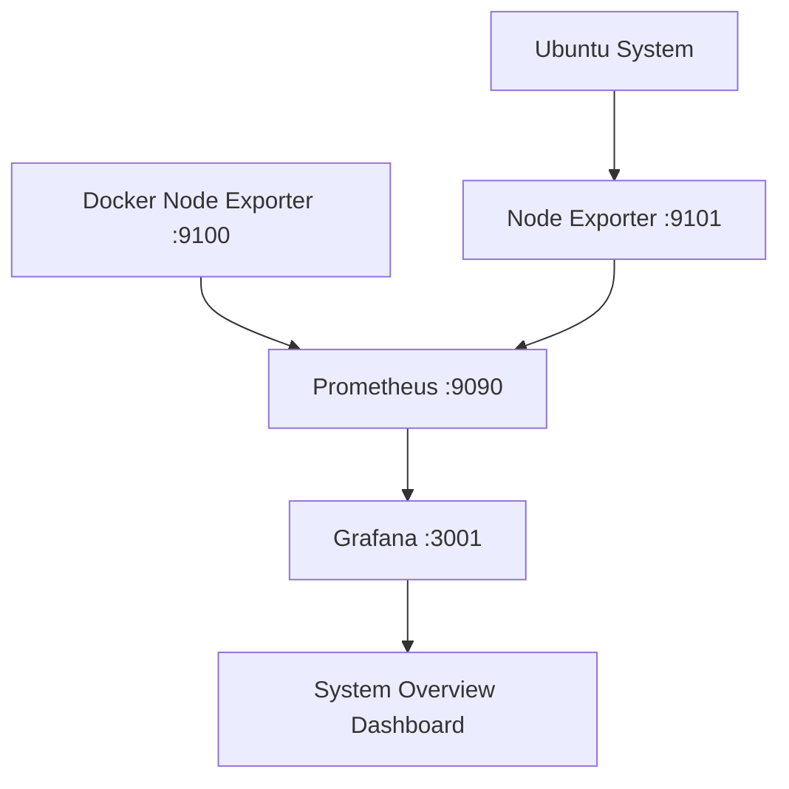

# System Monitoring with Prometheus, Node Exporter and Grafana

## 1. Project Overview

This project implements a system monitoring solution using **Prometheus, Node Exporter and Grafana**.

It collects system-level metrics such as CPU usage, memory usage, disk utilization, network traffic and system uptime. Grafana visualizes these metrics through a real-time monitoring dashboard.

## 2. Technologies Used

- **Prometheus:** Metrics collection and monitoring.
- **Node Exporter:** Exposes system-level metrics.
- **Grafana:** Monitoring dashboards and visualization.
- **Docker:** Containerization.
- **Docker Compose:** Managing multiple services.
- **Ubuntu (WSL2):** Linux environment.

## 3. Architecture



Prometheus uses a pull-based monitoring approach. It periodically scrapes metrics from the exporters and stores them as time-series data. Grafana queries Prometheus and displays the results.

## 4. Project Structure

```text
devops-monitoring/
│
├── docker-compose.yml
├── README.md
│
├── prometheus/
│   └── prometheus.yml
│
└── grafana/
    ├── provisioning/
    │   ├── datasources/
    │   │   └── prometheus.yml
    │   └── dashboards/
    │       └── dashboard.yml
    │
    └── dashboards/
        └── system-overview.json
```

## 5. Services and Ports

| Service | Port | Purpose |
|---|---:|---|
| Prometheus | 9090 | Metrics collection |
| Docker Node Exporter | 9100 | Container system metrics |
| Ubuntu Node Exporter | 9101 | Ubuntu system metrics |
| Grafana | 3001 | Dashboard visualization |

## 6. Setup and Installation

### Prerequisites

- Docker Desktop with WSL2 integration
- Ubuntu on WSL2
- Docker Compose

### Start the Monitoring Stack

Clone the repository:

```bash
git clone YOUR_GITHUB_REPOSITORY_URL
cd devops-monitoring
```

Start all Docker services:

```bash
docker compose up -d
```

Check running containers:

```bash
docker compose ps
```

### Start Ubuntu Node Exporter

The Ubuntu Node Exporter runs separately from Docker Compose.

Download and extract the appropriate Node Exporter Linux release, then run:

```bash
cd ~/node_exporter-1.13.1.linux-amd64
./node_exporter --web.listen-address=:9101
```

Keep this terminal running.

### Access the Services

- Prometheus: http://localhost:9090
- Prometheus Targets: http://localhost:9090/targets
- Grafana: http://localhost:3001
- Node Exporter metrics: http://localhost:9100/metrics
- Ubuntu Node Exporter metrics: http://localhost:9101/metrics

Log in to Grafana using your configured credentials.

## 7. Important Node Exporter Metrics

| Metric | Description |
|---|---|
| `node_cpu_seconds_total` | CPU time spent in different modes |
| `node_memory_MemTotal_bytes` | Total system memory |
| `node_memory_MemAvailable_bytes` | Available system memory |
| `node_filesystem_size_bytes` | Total filesystem size |
| `node_network_receive_bytes_total` | Total network bytes received |

## 8. Useful PromQL Queries

### CPU Usage (%)

```promql
100 - (avg(rate(node_cpu_seconds_total{mode="idle"}[5m])) * 100)
```

### Memory Usage (%)

```promql
(1 - node_memory_MemAvailable_bytes / node_memory_MemTotal_bytes) * 100
```

### Disk Usage (%)

```promql
100 * (1 - node_filesystem_avail_bytes{job="ubuntu-node-exporter",mountpoint="/"} / node_filesystem_size_bytes{job="ubuntu-node-exporter",mountpoint="/"})
```

### Network Incoming Traffic

```promql
rate(node_network_receive_bytes_total[5m])
```

### Network Outgoing Traffic

```promql
rate(node_network_transmit_bytes_total[5m])
```

### System Uptime

```promql
time() - node_boot_time_seconds
```

### Monitoring Target Status

```promql
up
```

A value of `1` indicates that the target is UP, while `0` indicates that it is DOWN.

## 9. Grafana Dashboard

The **System Overview** dashboard contains eight panels:

1. CPU Usage
2. Memory Usage (%)
3. Ubuntu Disk Usage (%)
4. Network Traffic
5. System Uptime
6. Targets Status
7. Memory Used (GB)
8. Memory Total (GB)

Dashboard refresh interval: 15 seconds.

The dashboard JSON is available at:

`grafana/dashboards/system-overview.json`

## 10. Testing

- Verified all Prometheus monitoring targets are UP.
- Verified Prometheus metrics using PromQL.
- Tested Node Exporter availability.
- Observed CPU usage changes under workload.
- Verified memory, disk and network metrics in Grafana.
- Tested target status when Node Exporter was stopped and restarted.
- Verified Docker Compose startup and Grafana dashboard persistence after restart.

## 11. Start and Stop Commands

Start:

```bash
docker compose up -d
```

Stop:

```bash
docker compose down
```

View logs:

```bash
docker compose logs -f
```

Check containers:

```bash
docker compose ps
```

---

**Project:** Monitoring Basics – Prometheus, Exporters and Grafana

**Objective:** Build a working monitoring stack with metrics collection, visualization and automated service configuration.
